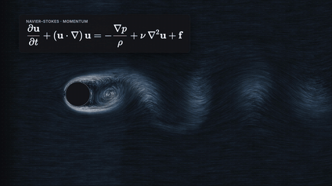
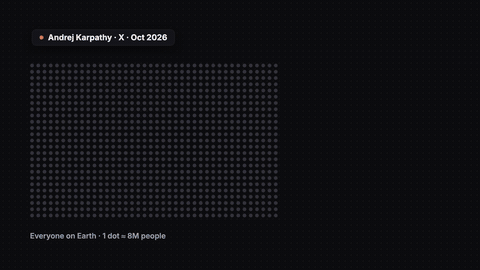

<div align="center">

# 🎬 youtube-animations

**The source code behind every animation on [@aleksgornik](https://www.youtube.com/@aleksgornik).**<br>
Engineering, AI and maths explainers: all code, no After Effects.

   

<table><tr><td width="33%" align="center"><a href="videos/2026-11-14-openai-math/navier_stokes"></a><br><sub><b><code>navier_stokes</code></b><br>Has OpenAI Solved Maths?</sub></td><td width="33%" align="center"><a href="videos/2026-10-06-ai-learn/m01_3b1b_homage"></a><br><sub><b><code>m01_3b1b_homage</code></b><br>How I use AI to learn engineering (anti brain rot studying)</sub></td><td width="33%" align="center"><a href="videos/2026-11-08-top-0.2-ai/hook_funnel"></a><br><sub><b><code>hook_funnel</code></b><br>Give me 15min, I'll make you a top 0.2% Engineer</sub></td></tr></table>

### [✨ Browse all 51 animations →](https://alexbond008.github.io/youtube-animations/)

<sub>Searchable gallery, every video, source links and 1080p renders</sub>

</div>

## What's in here

One folder per video in [`videos/`](videos), one subfolder per animation: its source, a GIF preview, and a README with the beat sheet (what appears when, on which spoken word) and the exact render command. Full 1080p renders are in [Releases](../../releases).

## 🛠️ How they're made

I describe each beat, a [Claude Code](https://claude.com/claude-code) agent writes and renders the animation, and I review the frames. Frames come from a frame counter, not a clock, so renders are deterministic.

| 🎨 Explainers | 📐 Maths | 💻 Screen demos | 🧩 Overlays |
|:-:|:-:|:-:|:-:|
| HTML + SVG/Canvas, captured by Playwright | [Manim](https://www.manim.community) + a small Python frame engine | HTML replicas with a synthetic cursor | [Remotion](https://www.remotion.dev) |

<details><summary><b>▶️ Run one yourself</b></summary>

```bash
git clone https://github.com/alexbond008/youtube-animations && cd youtube-animations
./scripts/setup_fonts.sh            # copies the OFL fonts into every animation's src/fonts
cd videos/2026-11-08-top-0.2-ai/hook_funnel/src
npm install && npx playwright install chromium-headless-shell
node render.mjs main 22 ../hook_funnel_1080p.mp4 ../qa 0.3,5,9,14,21.9   # each folder's README has its command
```

Needs Node 20+, ffmpeg, and Python 3.12 for the Manim scenes. Written on a Mac; elsewhere, set `FFMPEG` and `CHROME`.

</details>

---

<sub>Code: [MIT](LICENSE) · Renders and previews: [CC BY-NC 4.0](https://creativecommons.org/licenses/by-nc/4.0/), please credit the channel · Fonts: SIL OFL · Inspired by [3b1b/videos](https://github.com/3b1b/videos)</sub>
