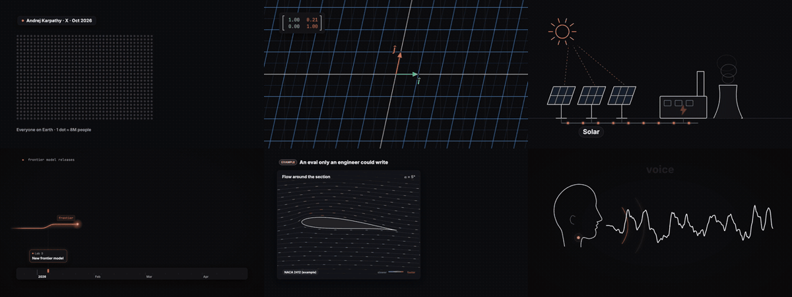
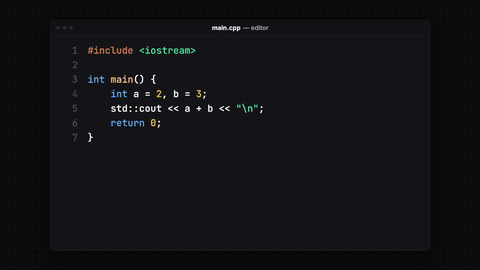
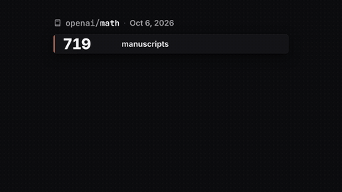
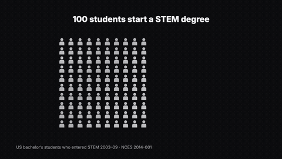
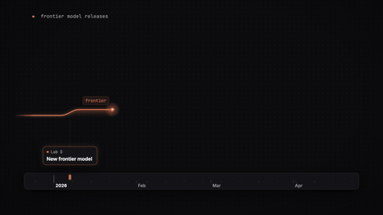
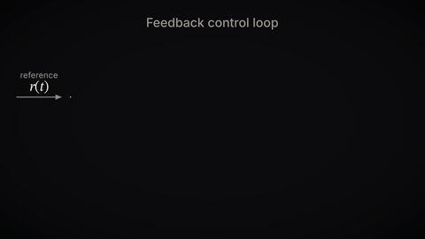
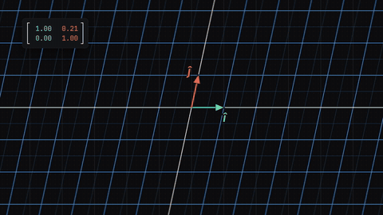

<div align="center">

# 🎬 youtube-animations

**The source code behind every animation on [@aleksgornik](https://www.youtube.com/@aleksgornik).**<br>
Engineering, AI and maths explainers, all of them code, none of them After Effects.



   

</div>

## ✨ Latest: [Has OpenAI Solved Maths?](videos/2026-11-14-openai-math)

OpenAI's maths repo in numbers, a real lattice-Boltzmann Navier–Stokes flow, Fourier/FFT, Lean as a compiler for maths, paper-vs-Lean mismatch, rendered LaTeX and far-fetched theory slides.

<p align="center"><a href="videos/2026-11-14-openai-math/navier_stokes"></a> <a href="videos/2026-11-14-openai-math/lean_compiler"></a> <a href="videos/2026-11-14-openai-math/repo_stats"></a></p>

## 📺 Every video

Click a video for all its animations, each with a beat sheet and a one-line render command.

| | Video | Animations | |
|:-:|---|:-:|:-:|
| <a href="videos/2026-11-14-openai-math/navier_stokes"></a> | **[Has OpenAI Solved Maths?](videos/2026-11-14-openai-math)**<br><sub>OpenAI's maths repo in numbers, a real lattice-Boltzmann Navier–Stokes flow, Fourier/FFT, Lean as a compiler for maths, paper-vs-Lean mismatch, rendered LaTeX and far-fetched theory slides.</sub> | 9 | <sub>soon</sub> |
| <a href="videos/2026-11-08-top-0.2-ai/hook_funnel"></a> | **[Give Me X Min. I'll Make You a Top 0.2% AI User](videos/2026-11-08-top-0.2-ai)**<br><sub>Karpathy's AI-usage funnel, long-horizon agents, an Excalidraw workflow turned into subagents, evals on an airfoil, research agents and the knowledge-expiry curve.</sub> | 8 | <sub>soon</sub> |
| <a href="videos/2026-10-26-why-fail/hook_stem_attrition"></a> | **[The Real Reasons Why Engineering Students Fail](videos/2026-10-26-why-fail)**<br><sub>STEM attrition, isolation week, the medics comparison, skipping lectures and the fail loop.</sub> | 10 | [▶️ Watch](https://www.youtube.com/watch?v=uBAR_aZDiVk) |
| <a href="videos/2026-10-18-honest-qa/q1_release_cadence"></a> | **[Will AI Replace Engineers? (+7 Other Questions)](videos/2026-10-18-honest-qa)**<br><sub>Model release cadence, project visibility, your first fifty users, Python vs C++, and English at B2.</sub> | 5 | [▶️ Watch](https://www.youtube.com/watch?v=0YiiZA-hphk) |
| <a href="videos/2026-10-11-ee-ai/control_rl"></a> | **[Electrical Engineers Will Dominate AI](videos/2026-10-11-ee-ai)**<br><sub>Control vs RL loops, Fourier on a voice, text-to-PCB, the AI power chain and data-centre cooling.</sub> | 10 | [▶️ Watch](https://www.youtube.com/watch?v=BNFo5mwcX78) |
| <a href="videos/2026-10-06-ai-learn/m01_3b1b_homage"></a> | **[How I use AI to learn engineering (anti brain rot studying)](videos/2026-10-06-ai-learn)**<br><sub>3Blue1Brown-style maths homage, a jargon storm, GNNs on lungs, the NASA rover, and Claude Code subagents fanning out.</sub> | 9 | [▶️ Watch](https://www.youtube.com/watch?v=GPM5MgFEkpk) |

## 🛠️ How they're made

I describe each beat (what the viewer should get, and on which spoken word), a [Claude Code](https://claude.com/claude-code) agent writes and renders the animation, and I review the frames. Renders are deterministic: frames come from a frame counter, not a clock, so the same code always gives the same video.

| 🎨 Explainers | 📐 Maths | 💻 UI mocks | 🧩 Overlays |
|:-:|:-:|:-:|:-:|
| HTML + SVG/Canvas, captured by Playwright | [Manim](https://www.manim.community) + a small Python frame engine | HTML replicas, animated with Playwright | [Remotion](https://www.remotion.dev) |

<details><summary><b>▶️ Run one yourself</b></summary>

```bash
git clone https://github.com/alexbond008/youtube-animations && cd youtube-animations
./scripts/setup_fonts.sh            # copies the OFL fonts into every animation's src/fonts
cd videos/2026-11-08-top-0.2-ai/hook_funnel/src
npm install && npx playwright install chromium-headless-shell
node render.mjs main 22 ../hook_funnel_1080p.mp4 ../qa 0.3,5,9,14,21.9   # each folder's README has its command
```

Needs Node 20+, ffmpeg, and Python 3.12 for the Manim scenes. Written on a Mac; elsewhere, set `FFMPEG` and `CHROME`. Full 1080p renders live in [Releases](../../releases).

</details>

---

<sub>Code: [MIT](LICENSE) · Renders and previews: [CC BY-NC 4.0](https://creativecommons.org/licenses/by-nc/4.0/), please credit the channel · Fonts: SIL OFL · Inspired by [3b1b/videos](https://github.com/3b1b/videos)</sub>
