<div align="center">

# Animations from my YouTube videos

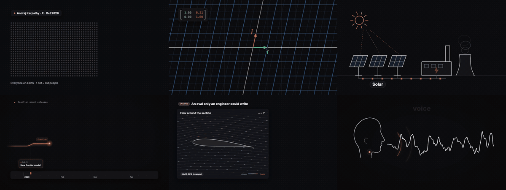

**42 animations · 5 videos · all built in code with Claude Code**

[YouTube](https://www.youtube.com/@aleksgornik) · [How they're made](#how-theyre-made) · [Run one yourself](#run-one-yourself)

</div>

Every video I put out on [my channel](https://www.youtube.com/@aleksgornik) gets a folder here with the source code for every animation in it, in the spirit of [3b1b/videos](https://github.com/3b1b/videos). I'm an engineer working on reinforcement learning, and I make videos about engineering, AI and how to actually get good at both. People kept asking how the visuals are made, so here's all of it.

## Videos

### [Give Me X Min. I'll Make You a Top 0.2% AI User](videos/2026-11-08-top-0.2-ai)

`2026-11-08` · 8 new animations · ▶️ coming soon

Karpathy's AI-usage funnel, long-horizon agents, an Excalidraw workflow turned into subagents, evals on an airfoil, research agents and the knowledge-expiry curve.

<p><a href="videos/2026-11-08-top-0.2-ai/hook_funnel">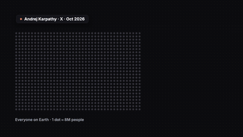</a> <a href="videos/2026-11-08-top-0.2-ai/knowledge_expiry">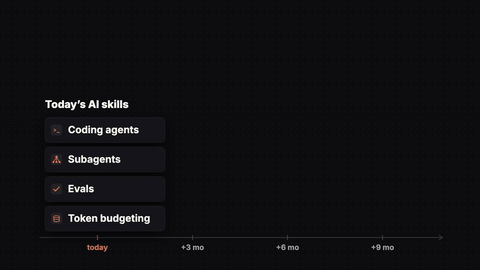</a> <a href="videos/2026-11-08-top-0.2-ai/long_horizon">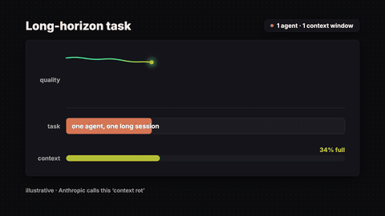</a></p>

### [The Real Reasons Why Engineering Students Fail](videos/2026-10-26-why-fail)

`2026-10-26` · 10 new animations · [▶️ watch on YouTube](https://www.youtube.com/watch?v=uBAR_aZDiVk)

STEM attrition, isolation week, the medics comparison, skipping lectures and the fail loop.

<p><a href="videos/2026-10-26-why-fail/hook_stem_attrition">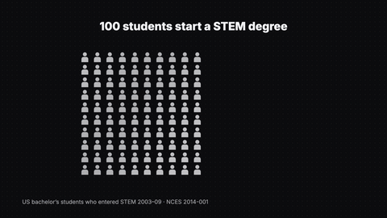</a> <a href="videos/2026-10-26-why-fail/p1_isolation_week"></a> <a href="videos/2026-10-26-why-fail/p2_medics">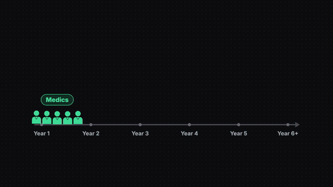</a></p>

### [Will AI Replace Engineers? (+7 Other Questions)](videos/2026-10-18-honest-qa)

`2026-10-18` · 5 new animations · [▶️ watch on YouTube](https://www.youtube.com/watch?v=0YiiZA-hphk)

Model release cadence, project visibility, your first fifty users, Python vs C++, and English at B2.

<p><a href="videos/2026-10-18-honest-qa/q1_release_cadence">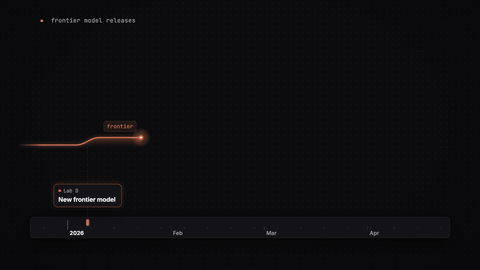</a> <a href="videos/2026-10-18-honest-qa/q2_project_visibility">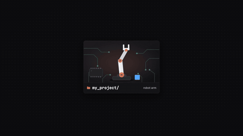</a> <a href="videos/2026-10-18-honest-qa/q3_fifty_users">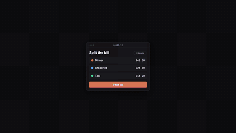</a></p>

### [Electrical Engineers Will Dominate AI](videos/2026-10-11-ee-ai)

`2026-10-11` · 10 new animations · [▶️ watch on YouTube](https://www.youtube.com/watch?v=BNFo5mwcX78)

Control vs RL loops, Fourier on a voice, text-to-PCB, the AI power chain and data-centre cooling.

<p><a href="videos/2026-10-11-ee-ai/control_rl">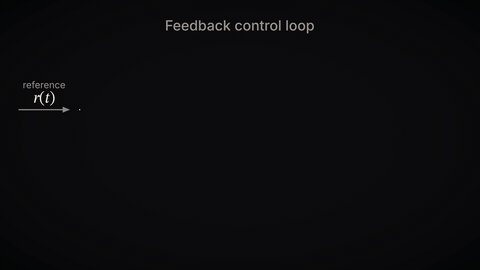</a> <a href="videos/2026-10-11-ee-ai/ee_relabel">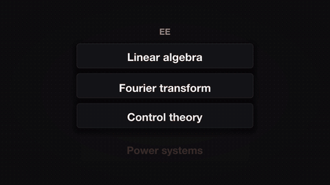</a> <a href="videos/2026-10-11-ee-ai/p1_maths_to_ml">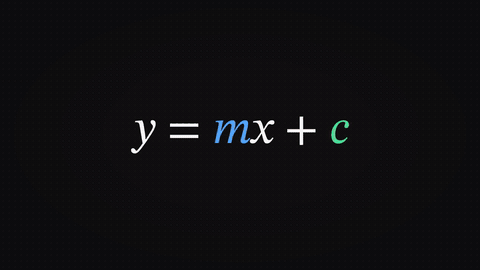</a></p>

### [How I use AI to learn engineering (anti brain rot studying)](videos/2026-10-06-ai-learn)

`2026-10-06` · 9 new animations · [▶️ watch on YouTube](https://www.youtube.com/watch?v=GPM5MgFEkpk)

3Blue1Brown-style maths homage, a jargon storm, GNNs on lungs, the NASA rover, and Claude Code subagents fanning out.

<p><a href="videos/2026-10-06-ai-learn/m01_3b1b_homage">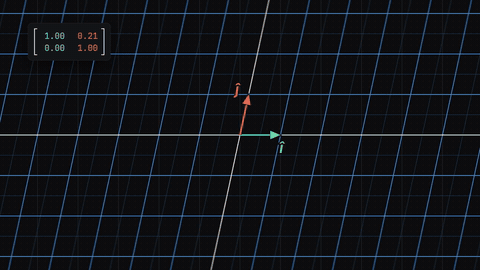</a> <a href="videos/2026-10-06-ai-learn/m02_jargon_storm">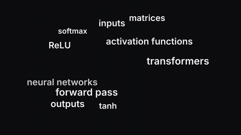</a> <a href="videos/2026-10-06-ai-learn/m03_gnn_lungs">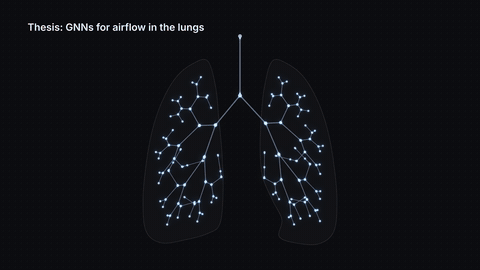</a></p>

## How they're made

There's no After Effects here. Every animation is code, written with [Claude Code](https://claude.com/claude-code) agents. I describe the beat (what the viewer should understand, and on which spoken word), and one agent writes and renders each animation. Then I review the frames.

| Kind | Stack | Example |
|---|---|---|
| Explainer scenes | HTML + SVG/Canvas in headless Chromium, captured frame-by-frame with Playwright, encoded with ffmpeg | `hook_funnel`, `p4_power_chain` |
| Maths | [Manim](https://www.manim.community), the library behind 3Blue1Brown, plus a small Python frame engine | `m01_3b1b_homage`, `m03_gnn_lungs` |
| UI / terminal mocks | Static HTML replicas animated with Playwright | `p4_subagents_fanout`, `alpha_brief` |
| Overlays (titles, lists, prompt cards, end screens) | [Remotion](https://www.remotion.dev) components | point titles, side lists, prompt cards, recap boards |

Every render is deterministic. The animation reads a frame number instead of a clock, so the same code always gives the same video, and each beat is timed to land on a word in the voiceover.

## Run one yourself

```bash
git clone https://github.com/alexbond008/youtube-animations && cd youtube-animations
./scripts/setup_fonts.sh            # copies the OFL fonts into every animation's src/fonts
cd videos/2026-11-08-top-0.2-ai/hook_funnel/src
npm install && npx playwright install chromium-headless-shell
node render.mjs main 22 ../hook_funnel_1080p.mp4 ../qa 0.3,5,9,14,21.9   # each folder's README has its command
```

Requirements: Node 20+, ffmpeg, and Python 3.12 for the Manim scenes. The scripts were written on a Mac; elsewhere, set `FFMPEG` and `CHROME` to your binaries.

## Repo layout

```
videos/<date>-<video>/<animation>/   README (beat sheet + render command), src/, preview.gif
fonts/                              Inter, JetBrains Mono, STIX Two (SIL Open Font License)
releases → GitHub Releases          full 1080p renders per video (kept out of git history)
```

## License

Code: [MIT](LICENSE). Rendered videos and previews: [CC BY-NC 4.0](https://creativecommons.org/licenses/by-nc/4.0/). Feel free to learn from them and remix them; please credit the channel. Fonts keep their own OFL licences.
