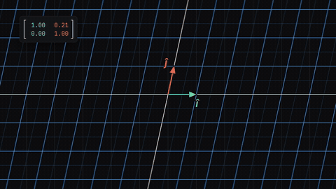
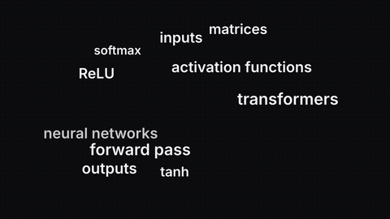
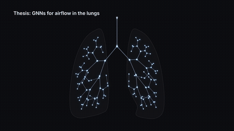
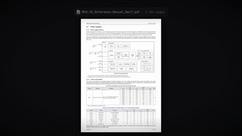
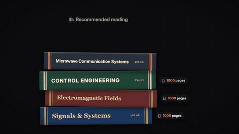

# How I use AI to learn engineering (anti brain rot studying)

▶️ **Watch:** https://www.youtube.com/watch?v=GPM5MgFEkpk

3Blue1Brown-style maths homage, a jargon storm, GNNs on lungs, the NASA rover, and Claude Code subagents fanning out.

Full-quality 1080p renders: [Releases → `ai-learn`](../../releases/tag/ai-learn)

| Preview | Animation |
|---|---|
|  | **[m01_3b1b_homage](m01_3b1b_homage)** — m01_3b1b_homage: grid transform that becomes a circuit |
|  | **[m02_jargon_storm](m02_jargon_storm)** — m02_jargon_storm: jargon overload collapses to "training loop" |
|  | **[m03_gnn_lungs](m03_gnn_lungs)** — m03_gnn_lungs: airway tree as a graph, and the 20 % you need |
|  | **[nasa_perseverance](nasa_perseverance)** — NASA Perseverance: Blender renders |
|  | **[p1_datasheet_mock](p1_datasheet_mock)** — p1_datasheet_mock |
|  | **[p2_books_1970](p2_books_1970)** — p2_books_1970 |
|  | **[p2_old_uni_webpage](p2_old_uni_webpage)** — p2_old_uni_webpage |
|  | **[p2_paper_flood](p2_paper_flood)** — p2_paper_flood |
|  | **[p4_subagents_fanout](p4_subagents_fanout)** — p4_subagents_fanout |

Each folder has its own README with the beat sheet (what appears when, and which spoken word it lands on) and the exact re-render command.
