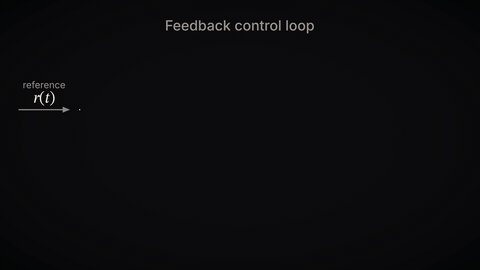
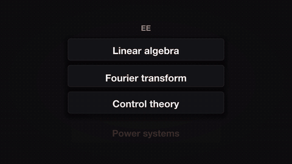
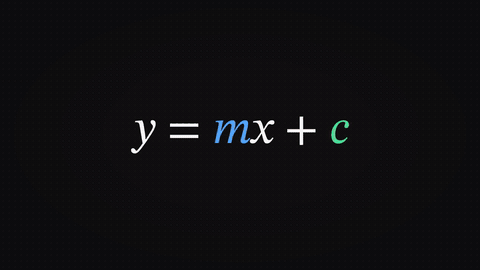
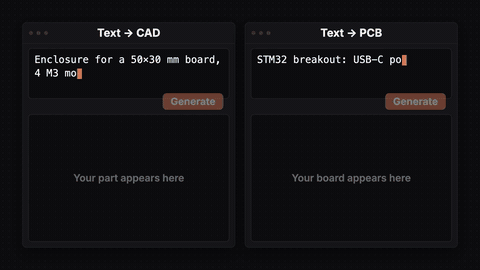
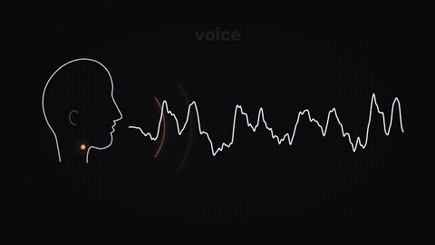
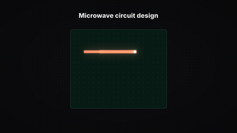
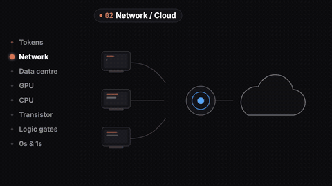
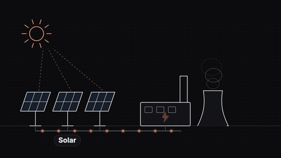
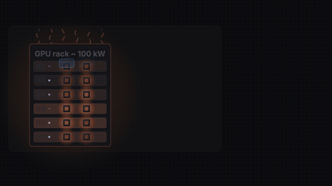
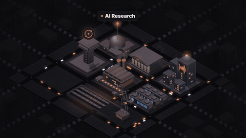

# Electrical Engineers Will Dominate AI

▶️ **Watch:** https://www.youtube.com/watch?v=BNFo5mwcX78

Control vs RL loops, Fourier on a voice, text-to-PCB, the AI power chain and data-centre cooling.

Full-quality 1080p renders: [Releases → `ee-ai`](../../releases/tag/ee-ai)

| Preview | Animation |
|---|---|
|  | **[control_rl](control_rl)** — 01 · Control loop vs RL loop (ee-ai, Point 3) |
|  | **[ee_relabel](ee_relabel)** — ee_relabel: EE terms get relabelled as AI names |
| ↩︎ | **[m01_3b1b_homage](../2026-10-06-ai-learn/m01_3b1b_homage)** — m01_3b1b_homage: grid transform that becomes a circuit *(first made for “How I use AI to learn engineering (anti brain rot studying)”)* |
| ↩︎ | **[m03_gnn_lungs](../2026-10-06-ai-learn/m03_gnn_lungs)** — m03_gnn_lungs: airway tree as a graph, and the 20 % you need *(first made for “How I use AI to learn engineering (anti brain rot studying)”)* |
|  | **[p1_maths_to_ml](p1_maths_to_ml)** — p1_maths_to_ml: two separate shots (Manim CE, house style) |
|  | **[p2_text_to_cad_pcb](p2_text_to_cad_pcb)** — p2_text_to_cad_pcb |
|  | **[p2_voice_fourier](p2_voice_fourier)** — p2_voice_fourier: voice -> sines -> spectrum -> Voice AI |
|  | **[p3_microwave](p3_microwave)** — p3_microwave: branch-line coupler, S-matrix, |S21| plot |
|  | **[p4_all_the_way_down](p4_all_the_way_down)** — p4_all_the_way_down |
|  | **[p4_power_chain](p4_power_chain)** — p4_power_chain |
|  | **[p4_water_cooling](p4_water_cooling)** — p4_water_cooling |
|  | **[recap_ai_town](recap_ai_town)** — recap_ai_town |

Each folder has its own README with the beat sheet (what appears when, and which spoken word it lands on) and the exact re-render command.
