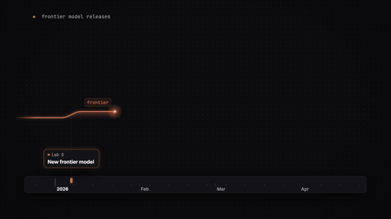
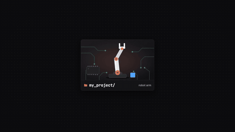
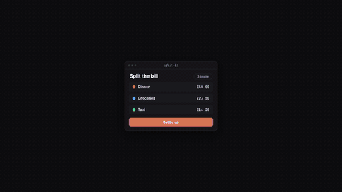
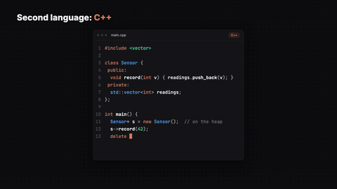
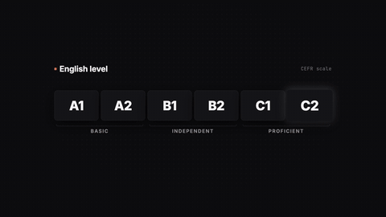

# Will AI Replace Engineers? (+7 Other Questions)

▶️ **Watch:** https://www.youtube.com/watch?v=0YiiZA-hphk

Model release cadence, project visibility, your first fifty users, Python vs C++, and English at B2.

Full-quality 1080p renders: [Releases → `honest-qa`](../../releases/tag/honest-qa)

| Preview | Animation |
|---|---|
| ↩︎ | **[control_rl](../2026-10-11-ee-ai/control_rl)** — 01 · Control loop vs RL loop (ee-ai, Point 3) *(first made for “Electrical Engineers Will Dominate AI”)* |
| ↩︎ | **[ee_relabel](../2026-10-11-ee-ai/ee_relabel)** — ee_relabel: EE terms get relabelled as AI names *(first made for “Electrical Engineers Will Dominate AI”)* |
| ↩︎ | **[p1_maths_to_ml](../2026-10-11-ee-ai/p1_maths_to_ml)** — p1_maths_to_ml: two separate shots (Manim CE, house style) *(first made for “Electrical Engineers Will Dominate AI”)* |
| ↩︎ | **[p2_text_to_cad_pcb](../2026-10-11-ee-ai/p2_text_to_cad_pcb)** — p2_text_to_cad_pcb *(first made for “Electrical Engineers Will Dominate AI”)* |
| ↩︎ | **[p4_all_the_way_down](../2026-10-11-ee-ai/p4_all_the_way_down)** — p4_all_the_way_down *(first made for “Electrical Engineers Will Dominate AI”)* |
| ↩︎ | **[p4_power_chain](../2026-10-11-ee-ai/p4_power_chain)** — p4_power_chain *(first made for “Electrical Engineers Will Dominate AI”)* |
| ↩︎ | **[p4_water_cooling](../2026-10-11-ee-ai/p4_water_cooling)** — p4_water_cooling *(first made for “Electrical Engineers Will Dominate AI”)* |
|  | **[q1_release_cadence](q1_release_cadence)** — q1_release_cadence |
|  | **[q2_project_visibility](q2_project_visibility)** — q2_project_visibility |
|  | **[q3_fifty_users](q3_fifty_users)** — q3_fifty_users |
|  | **[q4_python_cpp](q4_python_cpp)** — q4_python_cpp: "Python first, then C++ to understand it" |
|  | **[q5_english_b2](q5_english_b2)** — q5_english_b2: "How good does my English need to be?" |
| ↩︎ | **[recap_ai_town](../2026-10-11-ee-ai/recap_ai_town)** — recap_ai_town *(first made for “Electrical Engineers Will Dominate AI”)* |

Each folder has its own README with the beat sheet (what appears when, and which spoken word it lands on) and the exact re-render command.
