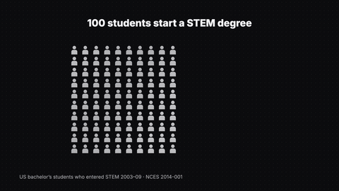
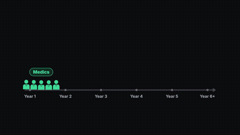
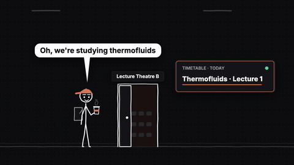
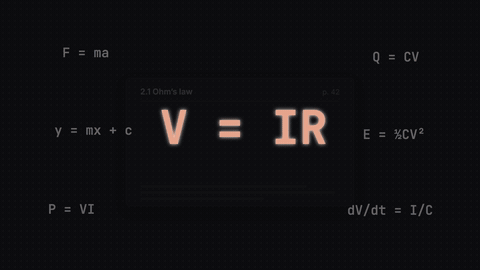
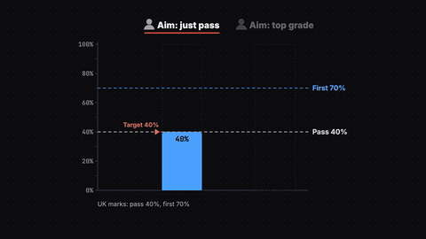

# The Real Reasons Why Engineering Students Fail

▶️ **Watch:** https://www.youtube.com/watch?v=uBAR_aZDiVk

STEM attrition, isolation week, the medics comparison, skipping lectures and the fail loop.

Full-quality 1080p renders: [Releases → `why-fail`](../../releases/tag/why-fail)

| Preview | Animation |
|---|---|
|  | **[hook_stem_attrition](hook_stem_attrition)** — hook_stem_attrition |
|  | **[p1_isolation_week](p1_isolation_week)** — p1_isolation_week |
|  | **[p2_medics](p2_medics)** — p2_medics: point 2 fix, "find a cohort, like medics do" |
|  | **[p2_timetable](p2_timetable)** — p2_timetable |
|  | **[p3_fly_home](p3_fly_home)** — p3_fly_home: point 3 intro, flying home |
|  | **[p3_skipping](p3_skipping)** — p3_skipping: point 3 "Skipping lectures" (3 concept animations) |
|  | **[p4_fail_loop](p4_fail_loop)** — p4_fail_loop: point 4, "failure itself isn't the issue" |
|  | **[p4_new_class](p4_new_class)** — p4_new_class: stick-figure "just pass" student |
|  | **[p4_synapse_ohm](p4_synapse_ohm)** — "It IS hard: it's applied maths" |
|  | **[p4_threshold](p4_threshold)** — p4_threshold |

Each folder has its own README with the beat sheet (what appears when, and which spoken word it lands on) and the exact re-render command.
