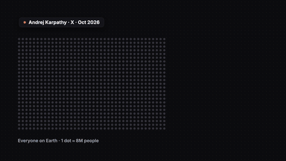
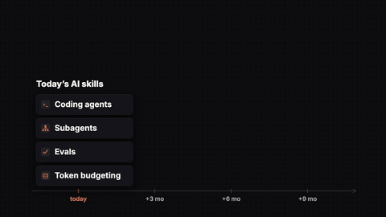
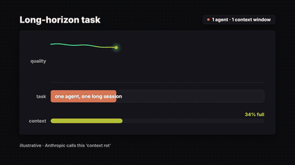
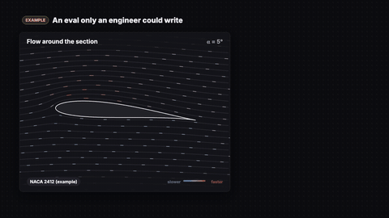
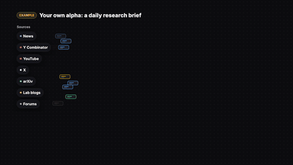
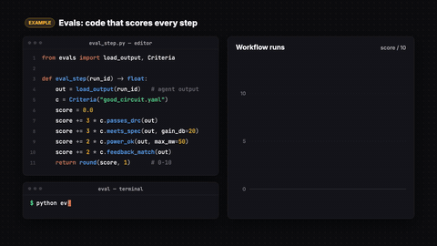
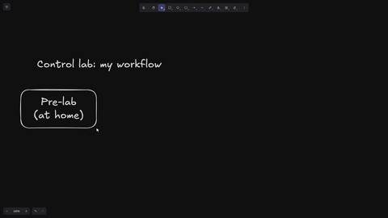
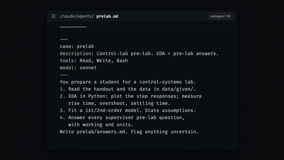

# Give Me X Min. I'll Make You a Top 0.2% AI User

▶️ Video coming soon on [the channel](https://www.youtube.com/@aleksgornik).

Karpathy's AI-usage funnel, long-horizon agents, an Excalidraw workflow turned into subagents, evals on an airfoil, research agents and the knowledge-expiry curve.

Full-quality 1080p renders: [Releases → `top-0.2-ai`](../../releases/tag/top-0.2-ai)

| Preview | Animation |
|---|---|
|  | **[hook_funnel](hook_funnel)** — Karpathy's AI-usage tiers (hook) |
|  | **[knowledge_expiry](knowledge_expiry)** — "Your knowledge expires" (Point 5) |
|  | **[long_horizon](long_horizon)** — one long session rots, sub-agents don't (Point 2) |
|  | **[airfoil_eval](airfoil_eval)** — Point 3 example (aerospace eval) |
|  | **[alpha_brief](alpha_brief)** — Point 4 "Research agents find your alpha" |
|  | **[evals_loop](evals_loop)** — Point 3 "Evals" |
|  | **[excalidraw_workflow](excalidraw_workflow)** — drawing the system in Excalidraw, then handing it to Claude (Point 2) |
|  | **[subagents_md](subagents_md)** — Claude Code subagents b-roll (control-lab example) |

_Some animations from this video aren't published here because they're built on private coursework._

Each folder has its own README with the beat sheet (what appears when, and which spoken word it lands on) and the exact re-render command.
