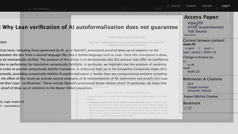
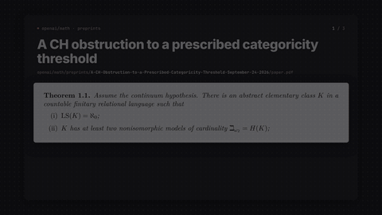
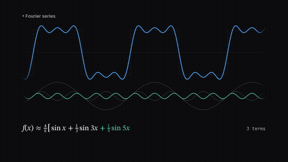
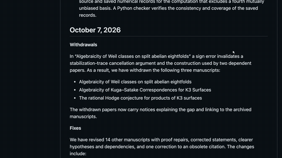
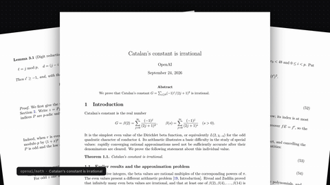
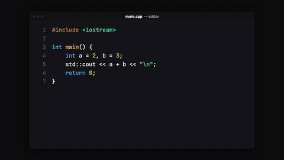
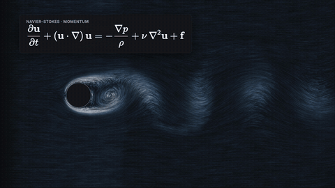
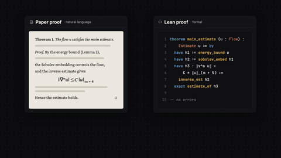
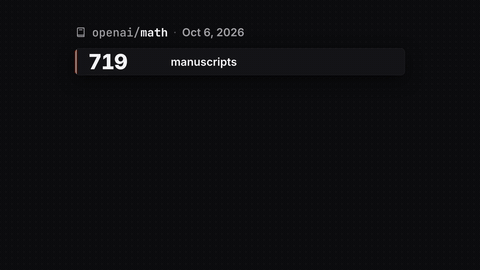

# Has OpenAI Solved Maths?

▶️ Video coming soon on [the channel](https://www.youtube.com/@aleksgornik).

OpenAI's maths repo in numbers, a real lattice-Boltzmann Navier–Stokes flow, Fourier/FFT, Lean as a compiler for maths, paper-vs-Lean mismatch, rendered LaTeX and far-fetched theory slides.

Full-quality 1080p renders: [Releases → `openai-math`](../../releases/tag/openai-math)

| Preview | Animation |
|---|---|
|  | **[arxiv_demo](arxiv_demo)** — arXiv abstract → click "View PDF" → scroll to the m+4 vs m+5 (Lean) mismatch, OpenScreen-style |
|  | **[farfetched_slides](farfetched_slides)** — three ultra-abstract openai/math preprints as a snappy slide deck, each with an orange "useful for… ?" arrow on the real typeset maths |
|  | **[fourier_fft](fourier_fft)** — a square wave builds from sine harmonics, then the FFT's O(n log n) meets the new O(n (log n)^(1−10⁻¹³)) bound |
|  | **[gh_demo](gh_demo)** — OpenScreen-style GitHub screen demos of openai/math (cursor, click ripples, auto-zoom) |
|  | **[latex_showcase](latex_showcase)** — the real typeset "Catalan's constant is irrational" paper (openai/math) fans in, glides down a dense page and zooms onto eq. (14): "good luck reading this" |
|  | **[lean_compiler](lean_compiler)** — "Lean is a compiler for maths": C++ compile, a real Lean 4 proof going green/red/green, and Mathlib's library fanning out |
|  | **[navier_stokes](navier_stokes)** — real lattice-Boltzmann flow past a cylinder (von Kármán vortex street) with the Navier–Stokes equation |
|  | **[paper_vs_lean](paper_vs_lean)** — a paper proof and a Lean proof that both "check out" but don't say the same thing (m + 4 vs m + 5) |
|  | **[repo_stats](repo_stats)** — openai/math repository card: 719-manuscript count-up with a "3 WITHDRAWN" stamp, plus a stats board that builds row by row |

Each folder has its own README with the beat sheet (what appears when, and which spoken word it lands on) and the exact re-render command.
