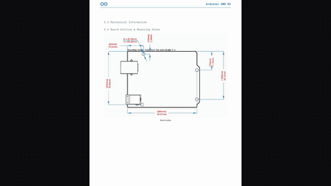
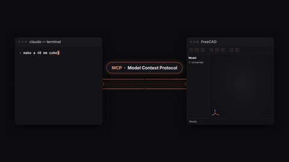
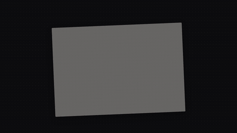

# Here's What AI Can Build in CAD Now

▶️ Video coming soon on [the channel](https://www.youtube.com/@aleksgornik).

Real Claude Code + FreeCAD (freecad-mcp) runs with measured fit checks, plus MCP / text-to-CAD / sketch-to-model explainers

Full-quality 1080p renders: [Releases → `ai-cad`](../../releases/tag/ai-cad)

| Preview | Animation |
|---|---|
|  | **[cad_1_arduino](cad_1_arduino)** — Arduino Uno enclosure designed by Claude Code in FreeCAD (freecad-mcp), real run + measured fit check |
|  | **[cad_2_drawing](cad_2_drawing)** — CC0 shaft drawing to a FreeCAD model by Claude Code (freecad-mcp), real run + measured comparison |
|  | **[mcp_bridge](mcp_bridge)** — Claude terminal talks to a CAD app over an MCP bridge; tool calls flow across and a cube appears, no clicks |
|  | **[sketch_to_model](sketch_to_model)** — a hand-drawn dimensioned bracket sketch is photographed by a phone and morphs into a clean 3D part |
|  | **[text_to_cad](text_to_cad)** — a typed prompt ("a box for my Arduino Uno") flies into an isometric enclosure that builds face by face |

_The football-boot animations from this video aren't published here: they use a third-party 3D model and personal photos._

Each folder has its own README with the beat sheet (what appears when, and which spoken word it lands on) and the exact re-render command.
